# 潮汐方舟 · 角色图鉴

> 深蓝纪元 183 年，外海。几乎每一个上了你木筏的人，都是被同一套水费制度甩出来的。

本图鉴收录 12 位角色：主角、7 位可入住的居民、1 位商人、实验室里的 2 位幸存者，以及配给官白砂。
身份和台词以《[故事](故事.md)》为准，数值以《[系统设计](系统设计.md)》和《[交互设计](交互设计.md)》为准。

立绘是 2.5D 彩色全身图，只用于图鉴和宣传。眼镜里显示的是单色绿光线稿，那是另一套素材。重画立绘用 `node tools/art/portraits.mjs`。

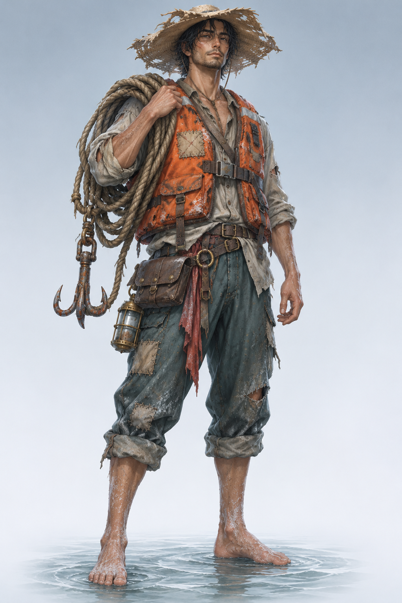
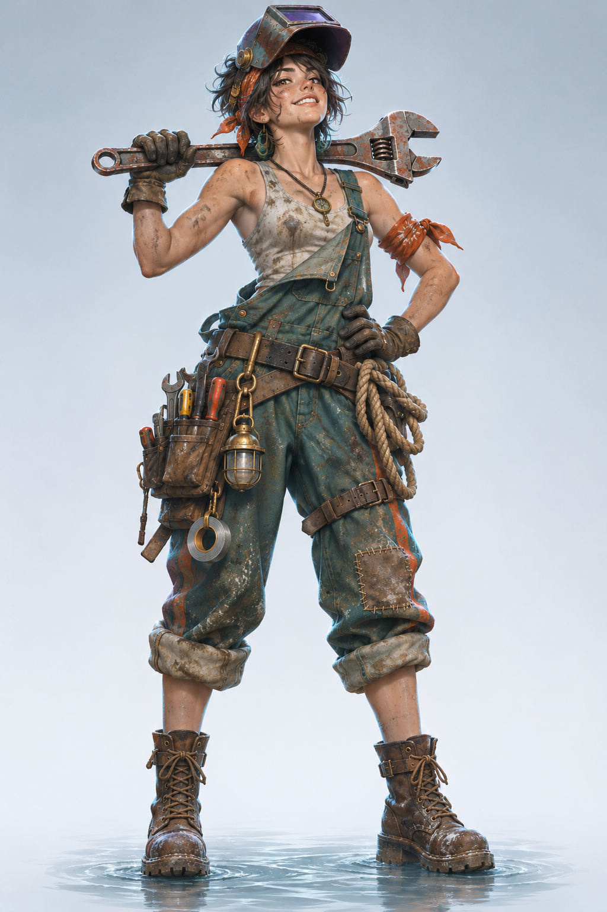
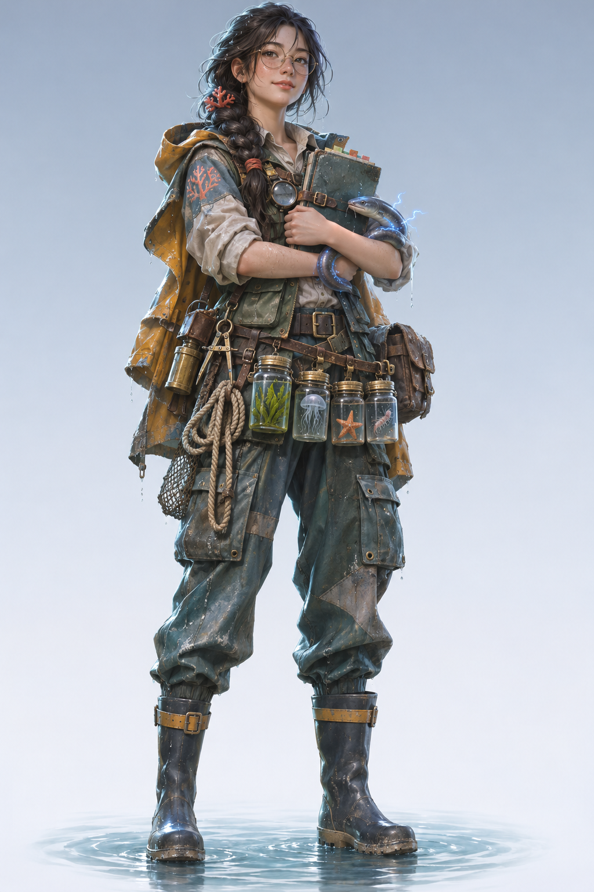
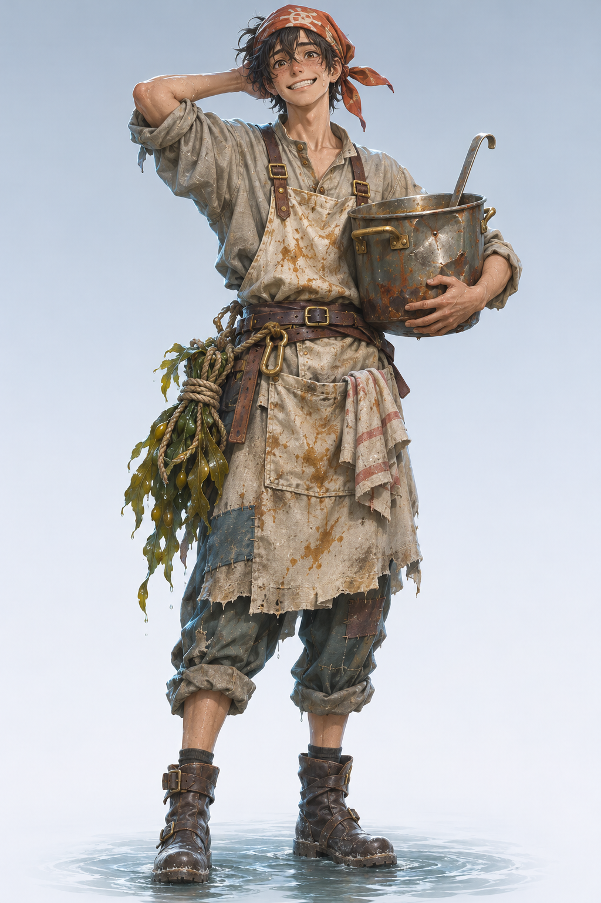
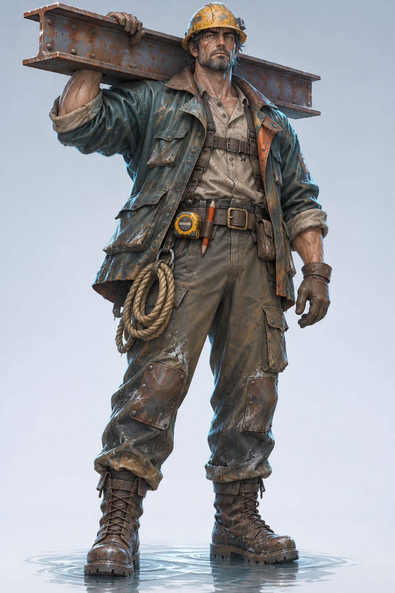
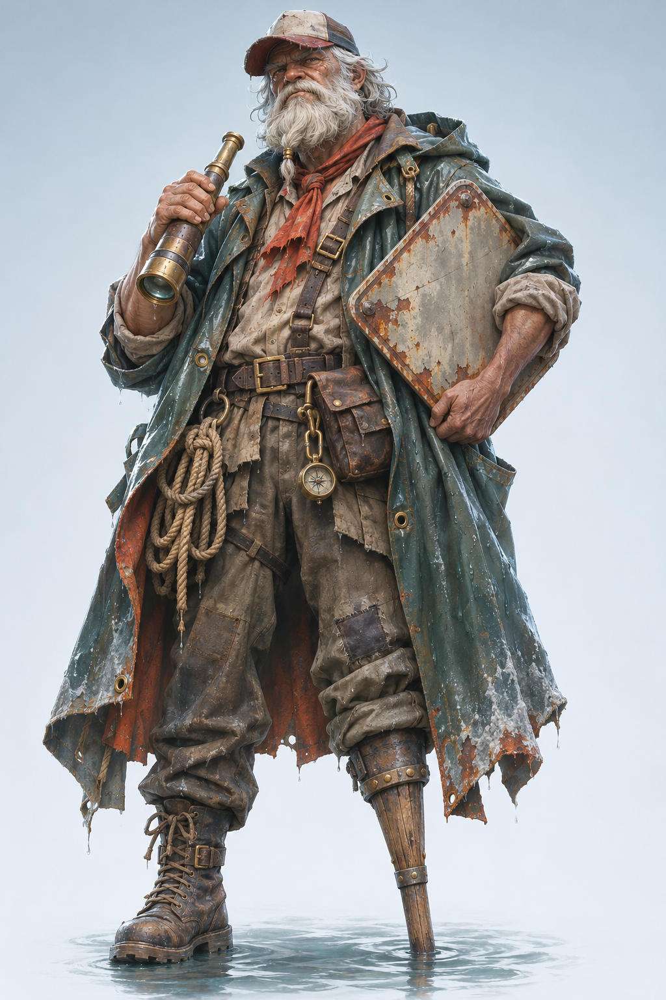
 
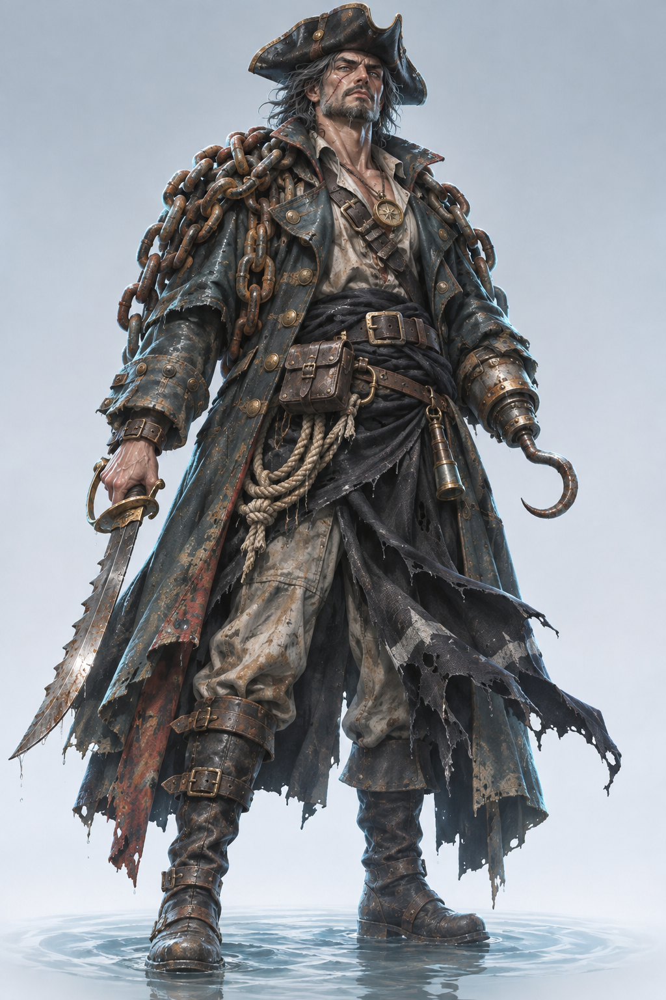
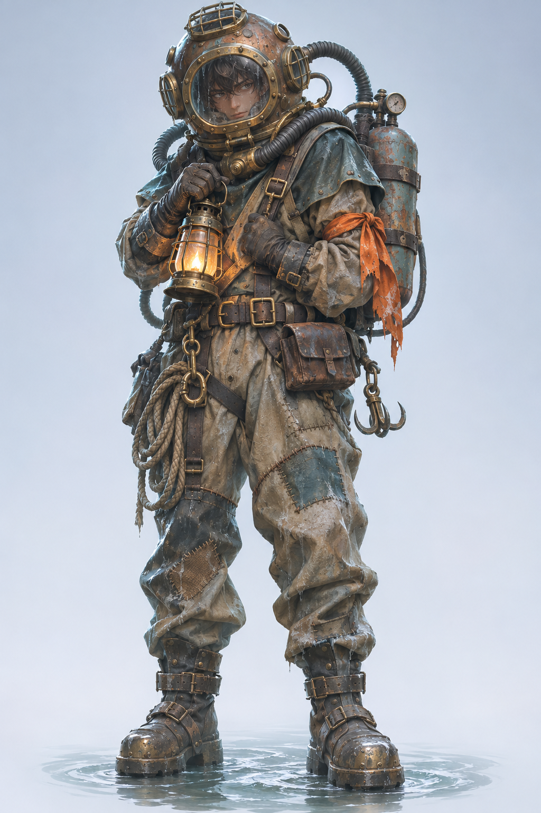
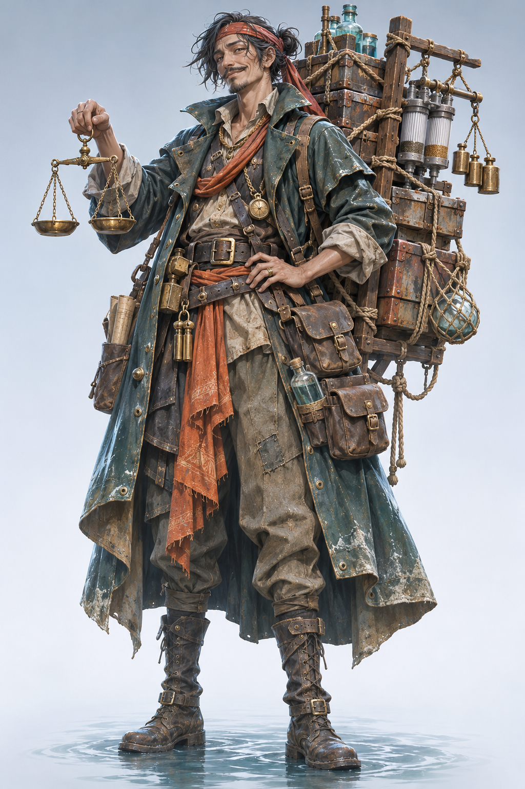
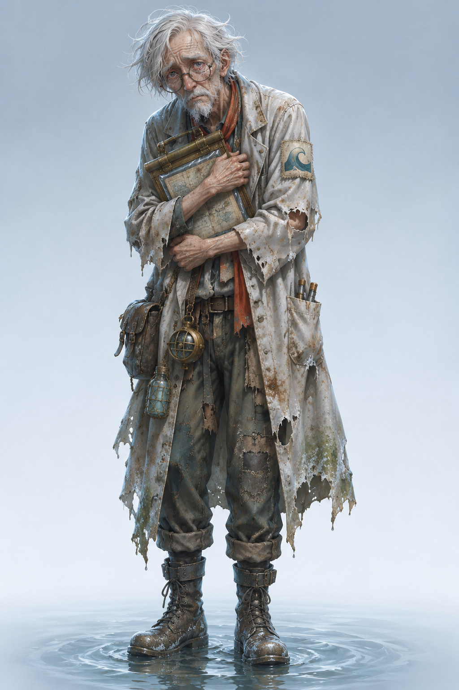
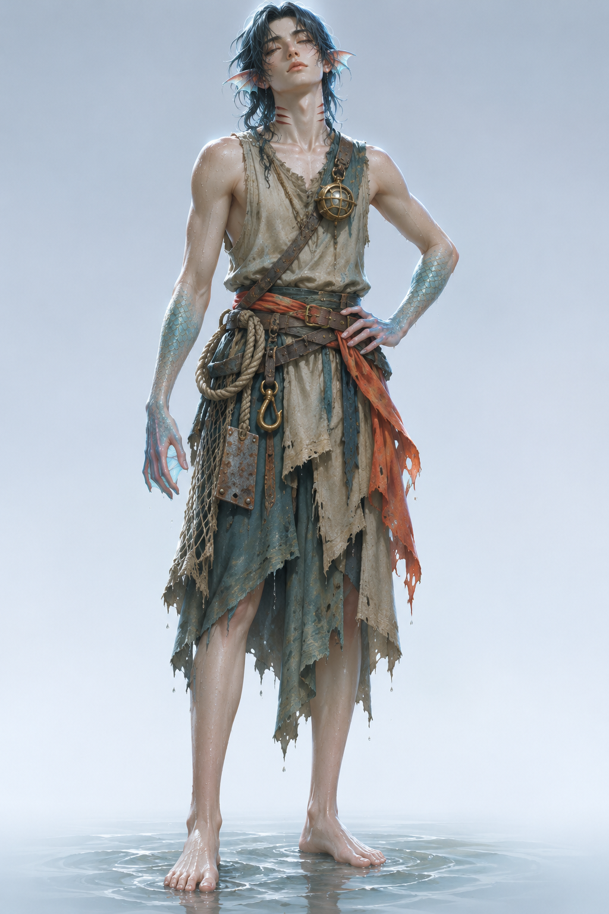
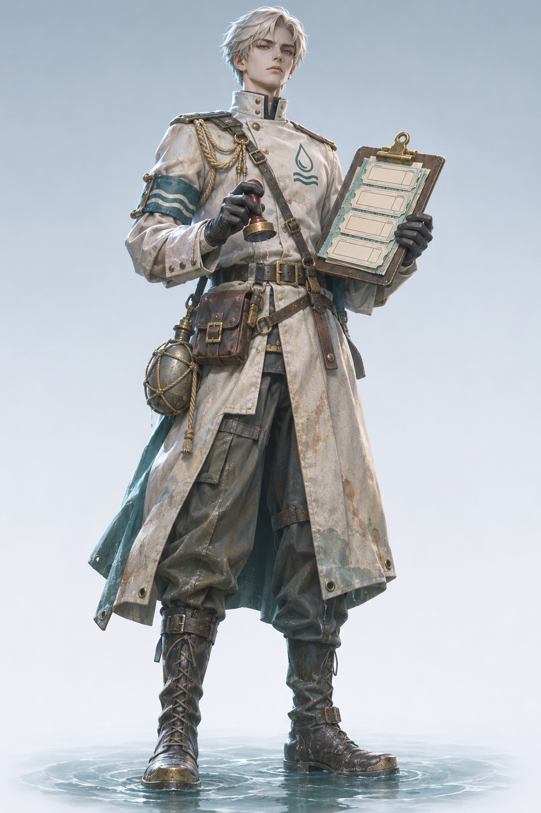

## 目录

| | 角色 | 身份 | 登场 | 阵营 |
|---|---|---|---|---|
| 01 | [你（老潮）](#01--你老潮) | 被驱逐的打捞工 | 序章 | 主角 |
| 02 | [铆钉](#02--铆钉) | 原城邦维修工 | 第一章 | 居民 |
| 03 | [珊瑚](#03--珊瑚) | 研究会叛逃的海兽学者 | 第二章 | 居民 |
| 04 | [小锅](#04--小锅) | 原城邦后厨帮工 | 第三章 | 居民 |
| 05 | [铁梁](#05--铁梁) | 建筑师 | 第四章 | 居民 |
| 06 | [秤砣](#06--秤砣) | 流动商人 | 第四章 | 商人 |
| 07 | [灯塔叔](#07--灯塔叔) | 老航海家，大淹没前的长途司机 | 第五章 | 居民 |
| 08 | [锈锚](#08--锈锚) | 海盗首领 | 第六章 | 居民（可选） |
| 09 | [气泡](#09--气泡) | 被打捞公司丢下的潜水员 | 第七章 | 居民 |
| 10 | [林博士](#10--林博士) | 深蓝计划研究员 | 第七章 | 盟友 |
| 11 | [潮生](#11--潮生) | 深蓝计划「适应体」 | 第七章 | 盟友 |
| 12 | [白砂](#12--白砂) | 海上城邦联盟配给官 | 序章 · 第七章 · 终章 | 对手 |

---

## 01 · 你（老潮）

<table><tr>
<td width="300"></td>
<td>

**身份**：被驱逐的打捞工，欠了三期淡水配给费
**性格**：不说话的主角
**外号由来**：别人叫你老潮，因为你总能在潮水退了以后还站着
**标志物**：破草帽、打满补丁的救生衣、肩上的钩索

序章里，白砂在你的名字上盖了章。第二天，城邦给了你一块木筏、几根废料和一台坏掉的过滤器，把你推向外海。没人觉得你能活过一周。

你捞上来的第一枚滤芯，让过滤器滴下了第一滴干净的水。从那时起你明白了：**水，原来是可以自己造的。**

</td>
</tr></table>

---

## 02 · 铆钉

<table><tr>
<td width="300"></td>
<td>

**身份**：年轻工程师，原城邦维修工
**性格**：嘴快手更快，嘴硬，爱拆东西
**口头禅**：「能拆的东西，就能装回去。」
**入住**：第一章。第 2 天起出海，必定漂来一只集装箱，她就锁在里面
**居民加成**：建造与升级的废料费用 −10%（向上取整）
**擅长海域**：残骸带
**音色**：`male-qn-qingse`

城邦的配给阀坏了，总得有人背锅。她被锁进集装箱扔进了海里。

> 「咳……谢了。我叫铆钉。」
> 「你这木筏，钉子全钉歪了。让我来。」

**聊聊**：「钉子要斜着进才咬得住。」「配给阀是自己漏的，真的。」「捞到铜线留给我。」
**危险夜**：「今晚潮大，我再钉一遍补丁。」
**派遣归来**：「能用的都拆回来了。」

</td>
</tr></table>

---

## 03 · 珊瑚

<table><tr>
<td width="300"></td>
<td>

**身份**：海兽学者，研究会的叛逃成员
**性格**：温和、执着，爱记笔记
**口头禅**：「它们不是怪物，是被逼着变的。」
**入住**：第二章。捞到她的漂流采样舱
**居民加成**：电鳗发电 +20%
**擅长海域**：近海
**音色**：`female-tianmei`

研究会要把电鳗做成一次性电池，她把样本偷了出来。醒来的第一句话是：「电鳗还活着吗？」后来是她预报了风暴季，也是她教大家在船底养藤壶。

**聊聊**：「电鳗今天电压很稳。」「笔记又潮了，还看得清。」「海在变，我们也在变。」
**危险夜**：「海鸟往南飞了，今晚小心。」
**派遣归来**：「顺手记了三种新藻类。」

</td>
</tr></table>

---

## 04 · 小锅

<table><tr>
<td width="300"></td>
<td>

**身份**：厨子，原城邦后厨帮工
**性格**：胆小、乐天，三句不离吃
**口头禅**：「饿着肚子什么都想不明白。」
**入住**：第三章。熬过第一次风暴潮后漂来的小舢板
**居民加成**：每日饮水 −1（正好抵掉自己那份）
**擅长海域**：近海
**音色**：`clever_boy`

> 「别开枪！我只带了一口锅！」
> 「后厨说我偷喝了汤。我就喝了一口！」

**聊聊**：「今晚海藻汤，明晚也是。」「水省着喝，汤可以淡点。」「锅底刻的日子快满了。」
**危险夜**：「锅都绑好了，晚饭照开。」
**派遣归来**：「带了点能下锅的。」

</td>
</tr></table>

---

## 05 · 铁梁

<table><tr>
<td width="300"></td>
<td>

**身份**：建筑师，「新的邻居」之一
**性格**：沉默、可靠，只相信量过三遍的数字
**口头禅**：「能盖七层。」
**入住**：第四章。庇护所升到 Lv5 那一夜，随邻居们的小船靠过来
**居民加成**：风暴防御 +5
**擅长海域**：残骸带
**音色**：`male-qn-jingying`

他扛着钢梁走上甲板，把地基量了三遍，只说了一句话。到了终章林博士说方舟要升到最后一层，他还是只说两个字：「能盖。」

**聊聊**：「地基还能再加一层。」「钢梁不说谎。」「量三遍，钉一遍。」
**危险夜**：「今晚的潮，防御差一点。」
**派遣归来**：「梁是好梁，扛回来了。」

</td>
</tr></table>

---

## 06 · 秤砣

<table><tr>
<td width="300"></td>
<td>

**身份**：流动商人，跟所有人做生意，包括城邦
**性格**：精明，但守信
**口头禅**：「价格从不便宜，货从不掺假。」
**登场**：第四章起每 3 天上午来一次，主界面出现「秤砣」菜单项，当天有效
**作用**：不入住，不喝水。每次摆出 3 笔交易，每笔当天限一次

| 付出 | 得到 |
|---|---|
| 废料 15 | 滤芯 1 |
| 废料 25 | 电鳗 1 |
| 淡水 10 | 废料 12 |
| 滤芯 2 | 淡水 15 |
| 废料 40 | 铁箱 1 |

> 「废料换滤芯，淡水换电鳗。三天后见。」

</td>
</tr></table>

---

## 07 · 灯塔叔

<table><tr>
<td width="300"></td>
<td>

**身份**：老航海家，木腿。大淹没前跑长途的司机
**性格**：暴躁、念旧，爱讲旧世界的事
**口头禅**：「大淹没前，这里是条高速公路。」
**入住**：第五章。骑着一只大海龟漂来
**居民加成**：解锁海龟拖船（出海可以选海域）；残骸带物品更宽 +10%
**擅长海域**：残骸带
**音色**：`Chinese (Mandarin)_Radio_Host`

> 「这片海，我在上面开过车。」
> 「近海早被捞空了。往北，是旧城的残骸带。给海龟套上拖架，我带路。」

第六章，是他先从望远镜里认出了锈锚的黑帆。

**聊聊**：「这底下原来是高速公路。」「海龟比车好，不用加油。」「残骸带楼顶还没捞完。」
**危险夜**：「起浪了，海龟不肯出来。」
**派遣归来**：「老路还认得。」

</td>
</tr></table>

---

## 08 · 锈锚

<table><tr>
<td width="300"></td>
<td>

**身份**：外海最有名的海盗首领。黑帆、铁钩，专挑亮着灯的庇护所下手
**性格**：狠，但讲规矩
**口头禅**：「强者拥有一切——这话是城邦教我的。」
**入住**：第六章结尾，可选。海盗夜防御够高击退他之后，他挂白旗上船谈和
**居民加成**：海盗不再来袭；风暴防御 +5
**擅长海域**：沉城
**音色**：`female-yujie`

> 「交出一半废料，或者打一场。」
> 「十年前，白砂也给我盖过章。」
> 「你造你的城，我不碰。要找城邦算账时，叫我。」

**聊聊**：「白砂的章，我也挨过。」「黑帆收了，刀还磨着。」「海上没规则，只有约定。」
**危险夜**：「今晚风大，我守夜。」
**派遣归来**：「顺路吓跑了两条小船。」

</td>
</tr></table>

---

## 09 · 气泡

<table><tr>
<td width="300"></td>
<td>

**身份**：深海潜水员，被打捞公司丢在海底
**性格**：话少，怕黑但从不承认
**口头禅**：「沉城的路我闭眼也认得。」
**入住**：第七章。在沉城捞上一根断气管，管子另一头拴着他
**居民加成**：沉城打捞 +1 钩
**擅长海域**：沉城
**音色**：`lovely_girl`

> 「……我还能下去。我认得路。」

后来是他在沉城捞到了「深蓝计划 · 潮汐组」的门禁卡：「门还通电。下面有人。」

**聊聊**：「下面比上面安静。」「铜盔里能听见心跳。」「沉城的路我闭眼也认得。」
**危险夜**：「今晚别下水，它们会醒。」
**派遣归来**：「下面的门又开了一扇。」

</td>
</tr></table>

---

## 10 · 林博士

<table><tr>
<td width="300"></td>
<td>

**身份**：旧世界研究员，深蓝计划成员，残骸带那张发电机图纸上的签名「林」
**性格**：疲惫、愧疚
**登场**：第七章。用门禁卡下潜沉没实验室，他坐在发光的屏幕前
**作用**：不算居民，不喝水。告诉你潮汐引擎的存在，并要求方舟升到最后一层

台词（剧透）

> 「……终于有人来了。」
> 「深蓝计划有两部分。一是让人适应海洋——二是让海水变成免费的淡水。」
> 「方舟要装下引擎，你的庇护所必须升到最后一层。」

</td>
</tr></table>

---

## 11 · 潮生

<table><tr>
<td width="300"></td>
<td>

**身份**：变异者，深蓝计划的「适应体」，颈侧有鳃，手指间有蹼
**性格**：平静，说话像潮声
**登场**：第七章，坐在实验室的舱角。无论终章选哪条路，最后都由他收尾
**作用**：不算居民，不喝水。第二幕的引子

台词（剧透）

> 「我是第一部分。」
> 「第二部分，被城邦沉进了海底。」
> 「海还在涨。深蓝计划的第二阶段，已经启动了。」

</td>
</tr></table>

---

## 12 · 白砂

<table><tr>
<td width="300"></td>
<td>

**身份**：海上城邦联盟的配给官
**性格**：冷静、讲制度
**口头禅**：「规则不是我定的，但我执行它。」
**登场**：序章给你盖章；庇护所升到 Lv7 时寄来税单；终章带船停在方舟外
**作用**：对手。终章二选一由他发起

> 「淡水配给费，又欠了三期。」
> 「你的庇护所未经登记，须缴纳淡水税。」
> 「把图纸交给联盟，你可以回城，免除全部欠费。」

结局里的他（剧透）

- **广播图纸**：每一条漂流的船都收到了图纸。白砂沉默了很久，摘下了配给官的徽章。
- **交出图纸**：你住进了城邦最高的那层楼。水费照收。

</td>
</tr></table>

---

## 附：居民速查

| 居民 | 入住 | 加成 | 擅长海域 | 音色 |
|---|---|---|---|---|
| 铆钉 | 第一章 | 建造废料 −10% | 残骸带 | male-qn-qingse |
| 珊瑚 | 第二章 | 发电 +20% | 近海 | female-tianmei |
| 小锅 | 第三章 | 每日饮水 −1 | 近海 | clever_boy |
| 铁梁 | 第四章 | 风暴防御 +5 | 残骸带 | male-qn-jingying |
| 灯塔叔 | 第五章 | 解锁海龟拖船，残骸带物品 +10% 宽 | 残骸带 | Chinese (Mandarin)_Radio_Host |
| 锈锚 | 第六章（可选） | 海盗不再来袭，风暴防御 +5 | 沉城 | female-yujie |
| 气泡 | 第七章 | 沉城打捞 +1 钩 | 沉城 | lovely_girl |

- 每位居民每天多喝 1 份淡水。
- 派遣一趟花 2 份淡水当口粮，40 秒后回来，带回 2 件；去擅长海域 +1 件，好感到 3 颗心再 +1 件。
- 好感 0–5 颗心：每次派遣归来 +1，每天第一次聊聊 +1。
